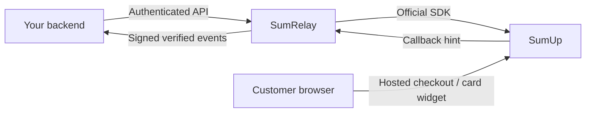

# SumRelay

**Verified SumUp payments for your app. Self-hosted, open source, and built for developers.**

[](https://github.com/dreykdrk7/sumrelay/actions/workflows/tests.yml)
[](LICENSE)

[Español](README.es.md) · [Quick start](#quick-start) · [API](docs/API.md) · [Contributing](CONTRIBUTING.md)

SumRelay is a small payment service that sits between your backend and SumUp.
Create a hosted checkout, verify the result with SumUp, and receive signed
notifications in your own application. SumRelay also runs recurring payment
schedules. Your application owns the plan, prices, taxes and access rules.

One installation connects **one application to one SumUp merchant**. It runs on
Django, PostgreSQL, the official SumUp Python SDK, and Docker Compose. The API is
language independent; a Python backend client is included.

## What you get

- Hosted checkouts with persistent idempotency keys and immutable order amounts.
- Verification of checkout, transaction, amount, currency, and merchant before confirming payment.
- Explicit uncertain states: a timeout cannot silently become a second charge.
- Signed HMAC webhooks, a durable delivery queue, and retries for up to 24 hours.
- Periodic reconciliation and detection of refunds and chargebacks reported by SumUp.
- Consented saved-card setup, encrypted tokens and scheduled collections with a trace per cycle.
- A Django admin panel for investigation, cancellation, reconciliation, and delivery retries.
- An isolated localhost sandbox, OpenAPI contract, tests, and Docker deployment files.



The browser return is for navigation. Your backend fulfills an order only after
checking a verified payment against its own order and recording fulfillment once.

## Quick start

You need Git, Python 3.10+ for the configuration helper, Docker Engine with
Compose v2, and a SumUp sandbox merchant/API key to create test payments.
Containers use Python 3.12 and PostgreSQL 17. Local ports 8000 and 8001 must be free.

```sh
git clone https://github.com/dreykdrk7/sumrelay.git
cd sumrelay
scripts/sandbox.sh init
```

Edit the private `.env.sandbox` file and set `SUMUP_API_KEY` and
`SUMUP_MERCHANT_CODE` from your **sandbox** merchant, then run:

```sh
scripts/sandbox.sh up
scripts/sandbox.sh check-credentials
```

- Admin: <http://localhost:8000/admin/>. Find the generated username and password in `.env.sandbox`.
- Local webhook receiver: <http://localhost:8001/>. This is a development tool.
- The sandbox helper configures the receiver and the exact return URL automatically.
- You can start the admin without a SumUp key; creating payments remains unavailable.

The helper generates independent secrets and never replaces an existing file.
Sandbox operations require SumUp to explicitly identify the merchant as sandbox.
If that metadata is missing, `check-connection` can check read access, but it
does **not** unlock sandbox payments. Localhost uses polling because SumUp cannot
deliver callbacks to your computer. [Sandbox guide](docs/SANDBOX.md).

```sh
scripts/sandbox.sh status
scripts/sandbox.sh logs
scripts/sandbox.sh down  # Keep the database and event volumes.
```

## Create your first checkout

Run this from your backend or a terminal. Set the `SUMRELAY_API_KEY` environment
variable to the generated `SAAS_API_KEYS` value from `.env.sandbox` (the
application's key, not the SumUp key).

```sh
curl http://localhost:8000/api/v1/payments/ \
  --request POST \
  --header "Authorization: Bearer $SUMRELAY_API_KEY" \
  --header 'Content-Type: application/json' \
  --header 'Idempotency-Key: order-42-attempt-1' \
  --data '{
    "reference": "ORDER-42",
    "amount": "19.95",
    "currency": "EUR",
    "description": "Example order",
    "return_url": "http://localhost:8001/return/"
  }'
```

An HTTP `202` or `uncertain=true` means **query the existing payment**; preserve
the idempotency key. Redirect only to an open, verified checkout. With the Python
client, use `checkout_url_for_redirect()` to apply these checks.

The [integration guide](docs/INTEGRATION.md) covers the Python client, signature
verification, and order fulfillment. The [OpenAPI contract](docs/openapi.json)
documents all request and response schemas; [API notes](docs/API.md) explain the
lifecycle. API error messages and admin labels currently use Spanish.

## Deploy your own installation

Use your own domain, database, merchant, and secrets. Start with `.env.example`;
payment creation and recurring charges are **disabled by default**. The optional
Caddy profile provides HTTPS. Configure the integration before explicitly enabling
the payment controls. [Installation, updates, backups, and recovery](docs/OPERATIONS.md).

## Scope and current limits

SumRelay is an early community project. Automated tests cover the processor and
SDK boundary with synthetic data; they do not certify your merchant configuration
or every payment method. Validate your installation in sandbox before using live funds.

- The service is a single-merchant backend, with shared server credentials per installation.
- Your app owns invoices, taxes, consent, and customer access.
- Recurring charges require SumUp tokenization support and customer authorization;
  authentication challenges need your app to involve the customer. [Recurring API](docs/RECURRING.md).
- Notifications are delivered at least once and may arrive out of order. Deduplicate durably.
- Refunds are detected; initiating refunds is outside the current API.
- Reconciliation visits known checkouts; it does not discover orders lost after restoring an old backup.
- `/health/` checks the database connection. Use `/api/v1/operations/status/` for worker activity.

## Development and community

```sh
python3.12 -m venv .venv
.venv/bin/pip install -r requirements-dev.txt
.venv/bin/pytest -q
.venv/bin/ruff check .
.venv/bin/ruff format --check .
```

SQLite is used for fast local tests. Concurrency tests require PostgreSQL and run
in CI. See [CONTRIBUTING.md](CONTRIBUTING.md) for the complete check commands.
Issues, documentation improvements, integrations, and pull requests are welcome.
See the [roadmap](ROADMAP.md) and [security policy](SECURITY.md).

## License and affiliation

[MIT](LICENSE). You can use, modify, and redistribute SumRelay, including in
commercial projects, under the license terms. Dependencies retain their own licenses.

SumRelay is an independent community project, not an official SumUp product.
SumUp and its trademarks belong to their respective owners.
